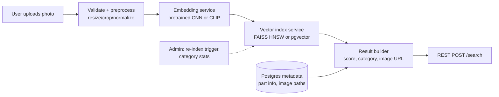

# Example: car-part-retrieval

## Request
> "Design an image embedding and vector search pipeline for retrieving car parts from an uploaded image."

## What the plugin does

**Route:** `car-part-retrieval` ("Using `car-part-retrieval` — final-year project context"). First question set: current project stage, available data and its licensing status, tech stack/GPU access, target part categories, evaluation requirements.

## Output (abridged)

**Current stage assessment:** assume stage = architecture/design (flagged as assumption; re-check with data inventory).

**Recommended architecture**

Baseline first: pretrained ResNet/CLIP features + cosine + FAISS flat or HNSW. Fine-tune only if the baseline's error analysis shows systematic misses (e.g., confusing similar panel types).

**Concrete next steps**
1. Implement preprocessing exactly and snapshot the config.
2. Build flat-index retrieval on the current unlabeled/cleaned subset — end-to-end today.
3. Hand-label 200 query images → ground truth for Precision@5 / MRR.
4. Compare 2 baseline models; record config + seed + metric table.
5. Only then: consider fine-tuning (e.g., triplet/contrastive) or re-ranking by metadata fitment.

**Implementation guidance:** small modules — `prepare.py` (raw→clean→split, with split done by part identity/source, not random per-image, to avoid near-duplicate leakage), `embed.py`, `build_index.py`, `search.py`, plus a `POST /search` FastAPI route.

**Evaluation plan:** Precision@K, Recall@K, mAP, MRR, p50/p95 latency, index build time/size. Results table per experiment row (model version, split, seed, metrics) — reproducible from a single `evaluate.py`.

**Risks and limitations:** scraped image licensing unverified; class imbalance in part categories; domain gap between studio and real user photos; GPU availability; scope creep into recommendation systems.

**Rules honored:** no labeled dataset assumed; classical/deep/multimodal retrieval regimes separated; everything sized for a final-year project (Docker Compose, free tools).
