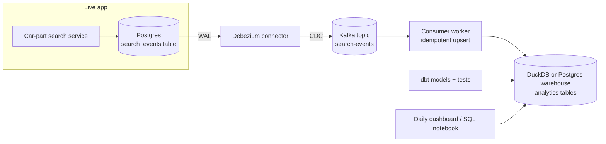

# Example: data-engineering

## Request
> "Create a beginner-friendly Kafka, CDC, and warehouse project to analyze car-part search events."

## What the plugin does

**Route:** `data-engineering`. First question: goal type (learning vs. implementation vs. architecture review). Sothy says learning, and that it can reuse a small events table from his car-part retrieval project.

## Output (abridged)

**Goal:** Learn Kafka + CDC + a warehouse by building one real pipeline: Debezium captures car-part search events from Postgres into Kafka; a consumer loads them into warehouse tables that power daily analytics.

**Architecture diagram**

**Data flow:** search service writes into `search_events` (append-only) → Debezium streams via replication slot into the topic → consumer dedupes on `event_id` and upserts into raw landing table → dbt models aggregate daily (top categories, searches per part, zero-result rate) → notebook/dashboard.

**Technology choices and trade-offs:** Debezium (best CDC fit, config fiddly) vs. polling cursor (simpler, at-least-once, no real-time); DuckDB (fast local analytics) vs. Postgres (already known, more realistic for app hosting); Docker Compose only — explicitly no Spark/Airflow for a first pass, sized for the actual event volume.

**Implementation steps (4 weekend-sized milestones)**
1. PoC with Docker Compose — search-service writes `search_events`, console-verified into a local topic.
2. Debezium end-to-end — snapshot + streaming verified; restart connector without duplicates or lost rows.
3. Consumer + warehouse upsert — dedupe on `event_id`; freshness check; learn why the consumer commits only after upsert succeeds.
4. dbt models + small dashboard — aggregates with tests (`unique(event_id)`, freshness, not_null), a weekly report, and a one-page write-up as proof of learning.

**Sample code/config:** Compose snippet (Postgres with `wal_level=logical`, Kafka, connect, consumer in Python for easier learning curve than embedding into the Spring boot app at the backend job — that work context stays out of the repo anyway by rule).

**Data-quality and monitoring checks:** raw row count vs. source count per day; freshness/max-age checks; nulls on critical event fields; upstream schema-change alert (Debezium schema-change topic); quality failure behavior = stop publishing next models, freeze warehouse build — explicit choice.

**Next learning task:** swap the consumer for a Kafka Streams job (no warehouse change) to experience stream processing; then optionally a small Airflow DAG orchestrating the daily dbt run.
